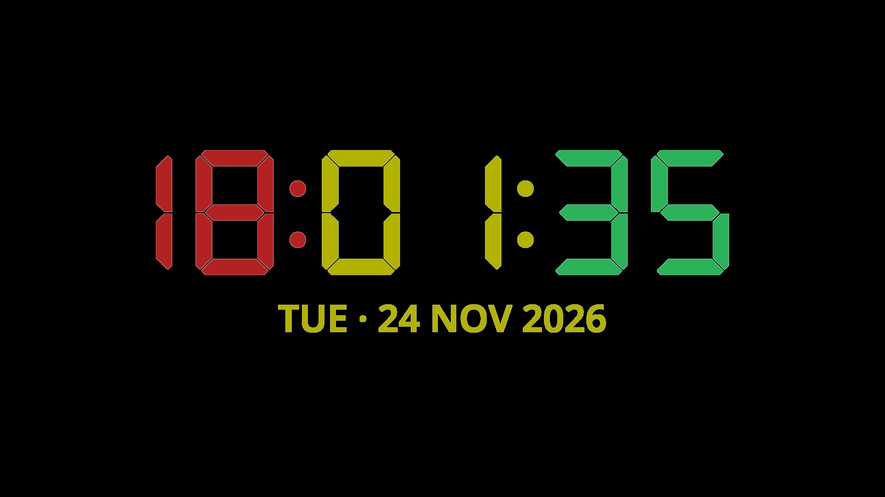
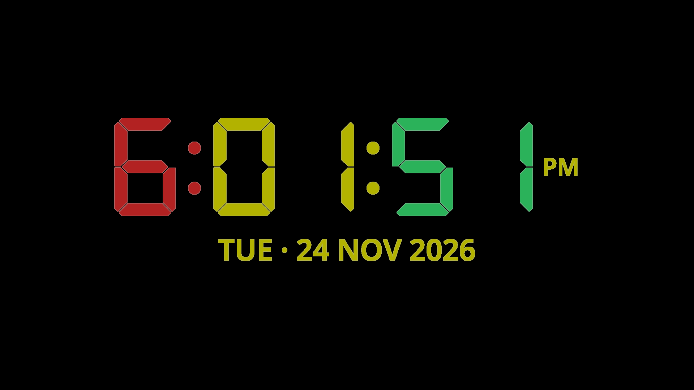
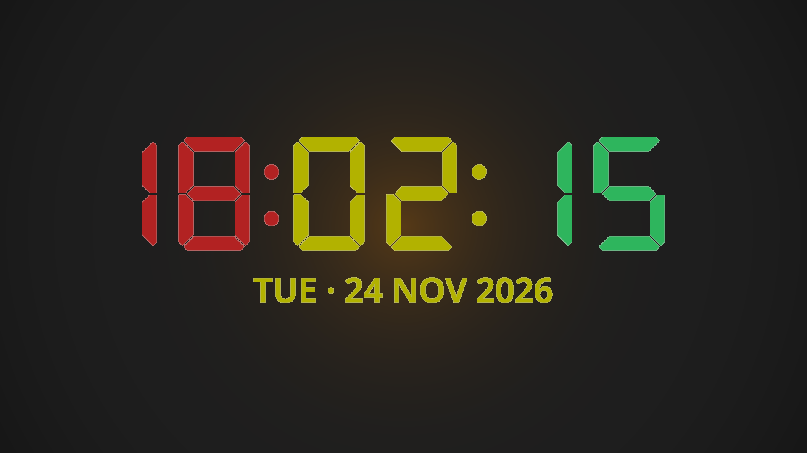
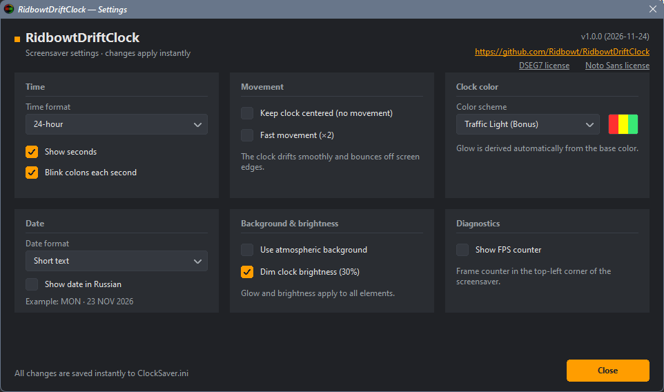

# Ridbowt Drift Clock 

A digital clock screensaver for Windows, featuring a colorful seven-segment display and date.

Ridbowt Drift Clock is a minimalist screensaver that displays the current time and date in a distinctive digital style.

## Features

- **Large Digital Clock:** Easy-to-read seven-segment display.
- **Color-Coded Time:** Hours, minutes, and seconds displayed in distinct colors.
- **Customizable Display:** Optional seconds display and blinking colons.
- **Date Display:** Current date shown below the clock.
- **Multiple Color Schemes:** Choose from several clock color combinations.
- **Adjustable Movement:** Customize the clock's movement and positioning.
- **Optional Background Effects:** Enable or disable atmospheric background effects.
- **Customizable Settings:** Adjust the clock appearance and behavior.

## Screenshots

### Default Clock

### US Clock (12-Hour Format)

### Background Clock

### Settings Window

## Installation

1. Go to the [Releases](https://github.com/Ridbowt/RidbowtDriftClock/releases) page.
2. Download the latest ZIP archive.
3. Extract the archive to a folder of your choice.
4. Right-click `RidbowtDriftClock.scr` and select **Install**.
5. Select Ridbowt Drift Clock in Windows Screen Saver Settings.

## System Requirements

- **Operating System:** Windows 10 or Windows 11 (64-bit).

## Building from Source

The project is written in Object Pascal and developed using:

- [Lazarus IDE](https://www.lazarus-ide.org/)
- [Free Pascal Compiler](https://www.freepascal.org/)

To build the application, open `RidbowtDriftClock.lpi` in Lazarus and compile the project.

## Fonts

This project uses the following fonts:

- **DSEG7 Classic** — seven-segment digital display font.
- **Noto Sans SemiBold** — supporting text font.

Both fonts are distributed under the SIL Open Font License 1.1. Their license files are included in the `LICENSES` directory.

## License

The Ridbowt Drift Clock source code is released under the MIT License.

Third-party fonts are distributed under their respective licenses. See the `LICENSES` directory for details.

---

**Ridbowt Drift Clock** — a colorful digital clock for your Windows desktop.

Windows screensaver, digital clock screensaver, desktop clock, seven-segment display, Windows clock, заставка часы, заставка с часами, цифровые часы, цифровая заставка, часы на рабочий стол, заставка для Windows, семисегментные часы, электронные часы